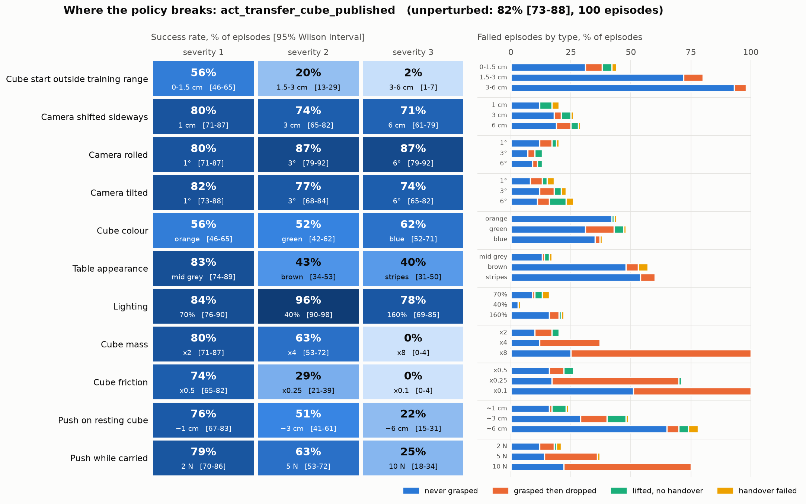

# Track B — Simulation

Where does a trained ACT policy break when the scene changes? This folder holds the evaluation
harness every track uses, the perturbed environments, the failure classifier and the robustness matrix.

## Result so far (published checkpoint, 100 episodes per cell, Apple M4)



- **Unperturbed: 82/100, 95% Wilson interval 73–88%.** The published figure is 83.0% over 500 episodes.
- **Worst failure, handed to Track C for C4: the cube starting outside the training range.**
  Success falls to 56% within 1.5 cm of the range, 20% at 1.5–3 cm and 2% at 3–6 cm. Of the
  222 failures in those three cells, 196 are "never grasped": the right gripper goes to where
  cubes used to be.
- Appearance matters more than camera pose. A brown or striped table, or a recoloured cube,
  costs 20 to 40 points. A 6 cm camera shift or a 6° tilt costs about 10; a 6° roll costs nothing measurable.
- Dimming the lights to 40% scored 96% (interval 90–98%), above the unperturbed run. Unexplained; treat it as a lead, not a result.
- Cube mass ×8 and friction ×0.1 give 0%, but those are grip-force limits of the simulated
  gripper, so more demonstrations will not fix them.
- A push that slides the resting cube 3 cm halves success. The policy executes 100 actions
  per prediction, so it does not see the cube move until the chunk ends. Track A's chunk-length and delay runs test this directly.

Full table: [`results/robustness_act_transfer_cube_published.md`](../../results/robustness_act_transfer_cube_published.md).

## Commands

Run from the repository root, with the venv active.

```bash
# B1: evaluate one checkpoint on one variant -> results/<checkpoint>__<variant>__seed1000_n100.json
python -m tracks.simulation.evaluate --checkpoint checkpoints/a1-reproduce-main/080000 --variant nominal --episodes 100

python -m tracks.simulation.evaluate --list-variants

# B2: render every variant for a check by eye -> outputs/variants/
python -m tracks.simulation.render_variants

# B4: one checkpoint against every variant (resumable), then the figure and table
python -m tracks.simulation.run_matrix --checkpoint checkpoints/a1-reproduce-main/080000
python -m tracks.simulation.plot_matrix

# B3: frame strips of the saved failure videos, for checking labels by eye
python -m tracks.simulation.review_failures results/<run>.json

python -m unittest discover -s tracks/simulation/tests -t .
```

`--checkpoint` takes any directory holding `config.json` and `model.safetensors`, including
`outputs/train/<run>/checkpoints/<step>/pretrained_model`. The results schema is in
[`results/README.md`](../../results/README.md).

On the M4 a 100-episode evaluation takes about 4 minutes alone, and the 34-variant matrix about 45 minutes with 6 workers.

## B1 — Harness

The harness runs its own rollout loop so it can read simulator state each step. It was checked
against `lerobot-eval` on seeds 1000–1002: same outcomes and the same summed rewards (67, 167, 190).
Episode `i` uses seed `seed + i`, so every checkpoint and variant sees the same episodes.

## B2 — Variants

Three severities per family; parameters are in `perturbations.py`.

| Family | Severity 1 / 2 / 3 |
|---|---|
| `cube_band` | cube starts 0–1.5 / 1.5–3 / 3–6 cm outside the training rectangle |
| `cam_shift` | top camera moved 1 / 3 / 6 cm sideways |
| `cam_roll` | camera rolled 1 / 3 / 6° about its optical axis |
| `cam_tilt` | camera tilted 1 / 3 / 6° off vertical |
| `cube_colour` | orange / green / blue |
| `table` | mid grey / brown / light and dark stripes |
| `light` | 70% / 40% / 160% |
| `mass` | ×2 / ×4 / ×8 (nominal 50 g) |
| `friction` | ×0.5 / ×0.25 / ×0.1 |
| `push_table` | push at step 30 slides the resting cube about 1 / 3 / 6 cm |
| `push_carry` | 2 / 5 / 10 N for 0.1 s, 15 steps after the cube is lifted |

Things to know:

- `cube_band` samples only from the band, not from the widened range, so each cell measures one distance.
- The severities were set from a 12-episode pilot so each family spans a visible range. They are not comparable across families.
- The stripes were meant to be a checkerboard; the table mesh has no texture coordinates.
- The 10 N carry push usually throws the 50 g cube off the table.

## B3 — Failure labels

| Label | Meaning |
|---|---|
| `never_grasped` | The right gripper never held the cube clear of the table. |
| `grasped_then_dropped` | The right gripper lifted the cube, then lost it before the left gripper touched it. |
| `lifted_no_handover` | The right gripper still held the cube in the air at the end; the left gripper never touched it. |
| `handover_failed` | The left gripper touched the lifted cube, but never held it clear of the table. |

"Lifted" means right-finger contact, no table contact and the cube at least 1 cm above rest for
3 consecutive steps. The reward stage alone is not enough: stage 2 fires for a single step when
the cube is nudged, and stage 3 fires when the left arm bumps a cube lying on the table.

Check by eye: 21 failure videos (all 18 unperturbed failures and one each from `friction_3`,
`push_carry_3` and `mass_2`) were compared with their labels as 8-frame strips, and all 21 agreed.
Caveats: Claude did the comparison, not a person, and the only camera is top-down, where height
shows only as the cube's apparent size. Several `grasped_then_dropped` episodes lose the cube
just as the left gripper arrives, without contact; a person might call those failed handovers.

## B4 — Open

Only the published checkpoint has been run. The team's checkpoints go through the same two commands once A1 finishes.
